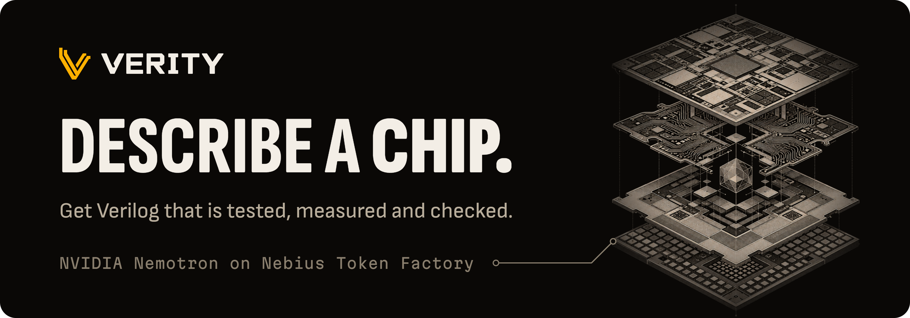
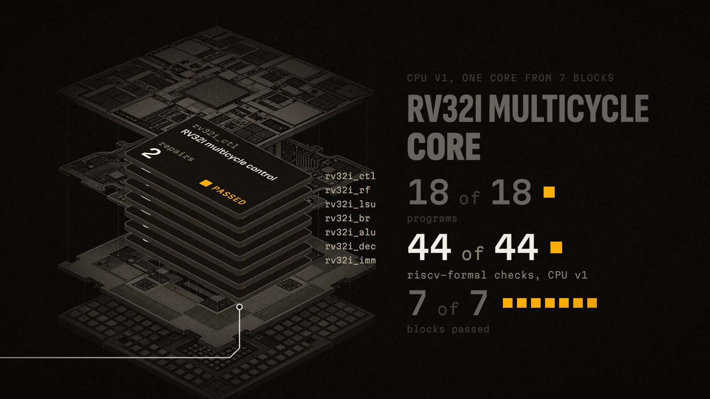

<p align="center">
  
</p>

<p align="center">
  <b>Describe a chip. A Nemotron agent writes the Verilog, tests it against a locked golden model, fixes its own bugs, and evolves smaller and faster versions that a formal check compares with v1.</b>
</p>

<p align="center">
  <a href="https://verity-frontend-mu.vercel.app">Live demo</a>
  &nbsp;&middot;&nbsp;
  <a href="https://youtu.be/hUz8faULujQ">Demo video (2:57)</a>
  &nbsp;&middot;&nbsp;
  <a href="https://verity-frontend-mu.vercel.app/studio/">Studio replay</a>
  &nbsp;&middot;&nbsp;
  <a href="#for-judges">For judges</a>
  &nbsp;&middot;&nbsp;
  <a href="ARCHITECTURE.md">Architecture</a>
</p>

**Verity is a chip design agent for RTL designers on small teams and EE students.** Code, never a model, decides what passes.

**Track:** Coding and Agentic Engineering, plus Best Use of Tavily. Nebius x NVIDIA Global AI Hackathon, built 2026-10-04 to 2026-10-29.

<p align="center">
  <a href="https://youtu.be/hUz8faULujQ"></a>
  <br><sub>A frame from the demo video. Click it to watch the 2:57 demo on YouTube.</sub>
</p>

## Why it matters

Writing Verilog is not the hard part; knowing it is right is. 44.2% of GPT-4-Turbo Verilog that passed its RTLLM v2 tests still failed a formal check (RealBench, arXiv 2507.16200). So Verity lets Nemotron write the design, and lets locked tests, measurements and formal checks judge it.

## What it does

1. **Fact check.** Code sets the verdict, citing live Tavily and Serper searches.
2. **Build.** Nemotron plans and writes three drafts at once; code tests them against a locked golden model the agent cannot see, and failures go back for repair.
3. **Improve.** Smaller or faster versions, measured against our own v1 and checked against it by Yosys EQY.
4. **Sign off.** More seeds, lint, proofs and a planted-bug count.
5. **Talk it through.** A chat agent answers from the run's data; a change runs only after you press Confirm.

Besides four chip families, the **CPU Lab** builds an RV32I CPU from seven blocks and a core Nemotron also writes, then upgrades it to a 2-stage pipeline or a 16-word cache.

## Results from real runs

| Run | Result | Cost, time |
|---|---|---|
| [RV32I CPU, one request](backend/evals/runs/2026-10-28-rv32i-cpu-job.json) | 7 of 7 blocks passed (12 repairs). Core: 18 of 18 programs, riscv-formal 44 of 44, 19 of 20 planted bugs caught. 3 blocks kept a version 1.9% to 4.4% smaller, each proven equal to its own v1 by EQY | $1.09, 33 min |
| [2-stage pipeline upgrade](backend/evals/runs/2026-10-28-pipeline-upgrade-job.json) | 18 of 18 programs, riscv-formal 43 of 44 (1 timeout). Cycles per instruction 4.025 to 1.239; Embench-IoT in 0.32x the time of CPU v1; clock period 4.84% longer | $0.15, 9 min |
| [Live ALU request](backend/evals/runs/2026-10-29-live-adder-run.json) | "Buildable with changes" from 2 Tavily and 1 Scholar searches; 6 versions, the winner v1 itself; 2 of 2 planted bugs caught | $0.036 plus $0.02 research, 154 s |

Area, clock and power come from Yosys on Nangate45 and OpenSTA; every gain is against our own v1.

## How Verity uses NVIDIA Nemotron

| Job | Model on Token Factory | $ per 1M tokens, in / out |
|---|---|---|
| Plan, three parallel drafts, repair | Nemotron 3 Ultra | 1.00 / 3.00 |
| Smaller or faster versions | Nemotron 3 Super | 0.30 / 0.90 |
| Sort a chat message | Nemotron 3.5 Lightning, thinking off | 0.06 / 0.24 |
| Fact check, chat, research summaries | GLM 5.3, which kept to what Verity can build in a bake-off | 1.40 / 4.40 |

Nemotron writes the plan and every line of Verilog, including the RV32I core; GLM 5.3 never writes Verilog. Locked tests and formal proofs, not a model, decide what passes. Model ids, routes and prices: `backend/config.toml`.

## Where Nebius Token Factory accelerated our workflow

- **One endpoint, every role.** Nine model roles share one OpenAI-compatible URL and key (`backend/verity/llm/openai_compat.py`); a role's model is one config line.
- **The right size per call.** Ultra reasons, Super iterates at about a third of Ultra's price, Lightning sorts chat.
- **Parallel drafts.** In a [10-run gate](backend/evals/gate-2026-10-16.md), 25 of 30 Ultra drafts passed alone; v1 needed no repair in any run.
- **Cheap probes first.** A [$0.69 probe](backend/evals/probe-2026-10-18.md) set the knob ranges; a $0.0016 probe chose the chat routes.
- **Capped spend.** A CPU for $1.09, a chip for $0.036, under server caps of $0.50 per chip run and $4.00 per CPU job.

**Other Nebius services.** Nebius Sandboxes is wired as the hosted tool runner (`backend/verity/tools/nebius_sandbox.py`) but waits on a project permission (403 "Insufficient permissions: import"); locally the tools run in Docker.

## Other tools

- **Tavily**: live web search in the fact check, the chat agent's research tool and each CPU block's research (`backend/verity/research/tavily.py`); 2 searches in the live run.
- **Serper**: Google Scholar and Google Patents.
- **Open EDA tools**, in one Docker image: Verilator, Icarus Verilog with cocotb, Yosys, OpenSTA, Yosys EQY, riscv-formal and Embench-IoT. OpenROAD is not run.

## For judges

1. **Watch.** [/studio](https://verity-frontend-mu.vercel.app/studio/) plays the real RV32I build and its upgrade.
2. **Ask.** On [/bench](https://verity-frontend-mu.vercel.app/bench/), type `Build me a small RV32I RISC-V CPU` or `An 8-bit ALU with add, subtract, AND, OR and XOR, plus a zero flag` for a verdict set by code, with live Tavily sources.
3. **Sign in to build** with the judges' account from the Devpost testing instructions; no credential is in this repository.

The hosted backend runs the fact check, research and chat live; full builds do not finish there yet, because of the Sandboxes permission above. The studio runs and the video come from a local backend with real Nemotron calls.

## Run it locally

Replay the recorded runs with Node 24 alone (no keys, backend or Docker):

```
git clone https://github.com/Sahir619/verity
cd verity/frontend && npm ci
npm run dev                            # http://localhost:3000
```

<details>
<summary>Full stack (Python 3.11 or newer, Node 24, Docker Desktop running)</summary>

```
cd backend
python -m venv .venv
.venv\Scripts\activate                 # Windows; source .venv/bin/activate elsewhere
pip install -e ".[dev]"
docker build -t verity-tools:0.2 --build-context bench=bench -f sandbox/Dockerfile sandbox   # 10 to 20 minutes the first time
verity-api                             # http://127.0.0.1:8000
```

The default `fake` provider costs $0 and still runs the real Docker tools; point the web app at it with `NEXT_PUBLIC_AGENT_URL=http://127.0.0.1:8000` in `frontend/.env.local`. Real models: `VERITY_PROVIDER=nebius` and `LLM_API_KEY` in `backend/.env`, the only place keys live (gitignored); `frontend/` holds none. To build a CPU without an account, set `VERITY_AUTH__LOCAL_ADMIN=true` on a development server. A $0 CPU job: `python evals/cpu_job_probe.py --provider fake --research fake --width 2 --containers 2`. More: [backend/README.md](backend/README.md), [frontend/README.md](frontend/README.md).

</details>

## Limits

- Full builds do not finish on the hosted backend yet.
- EQY proves a version equal to its own v1, not that the design is correct. A winner it cannot settle in time is labelled "Tested, not proven", and a winner can be v1 itself.
- The chat builds only four chip families, in fixed knob ranges, and the RV32I CPU; anything else gets the closest buildable chip.
- Power is a vectorless estimate, not a sign-off number.
- The tests miss some planted bugs (the CPU's immediate generator caught 12 of 16); a known gap in the sequence detector's tests stays, as fixing it would move the locked pack hash.

## More and license

[ARCHITECTURE.md](ARCHITECTURE.md) (who writes what, trust boundaries), [backend/CONTRACTS.md](backend/CONTRACTS.md) (interfaces), [backend/evals/runs/](backend/evals/runs/) (run records). Apache License 2.0 ([LICENSE](LICENSE), [NOTICE](NOTICE)); the chip tools run under their own licences (`backend/sandbox/README.md`). The improve loop takes its principles, not its code or numbers, from REvolution (arXiv 2510.21407).
